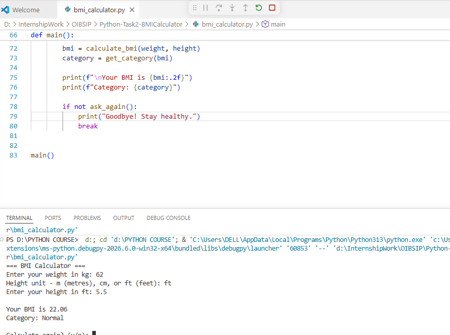
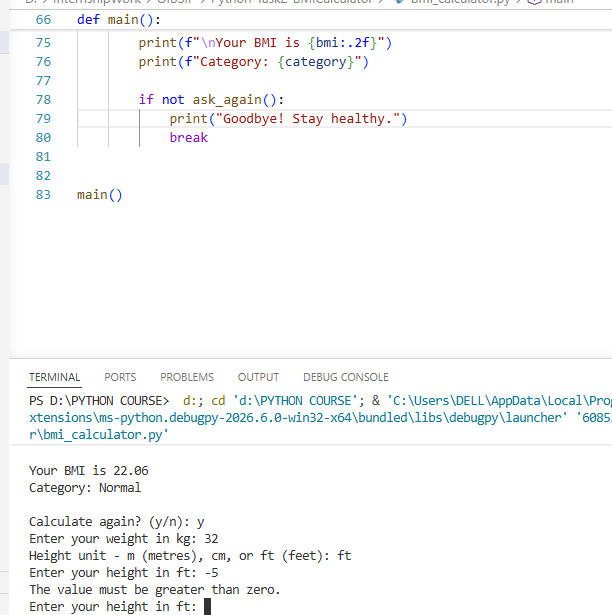
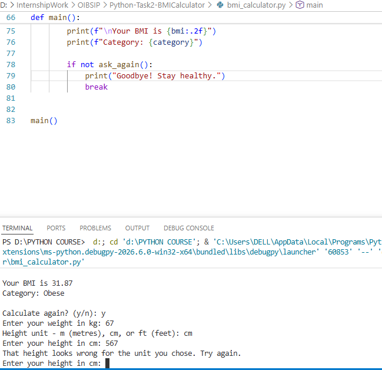

# BMI Calculator (Python)

Oasis Infobyte Internship | Python Programming | Task 2

## What it does
This is a command-line BMI calculator that I built in Python. It asks for my weight in kilograms and my height, then calculates the BMI and tells me whether the result is underweight, normal, overweight or obese. It keeps asking again if I type something wrong, so the program does not crash.

## Features
- Accepts height in metres, centimetres or feet
- Rejects letters, zero and negative values
- Rejects unrealistic heights
- Shows BMI to 2 decimal places with the health category
- Lets the user calculate again without restarting

## How to run
1. Install Python 3
2. Open Command Prompt in this folder
3. Run: `python bmi_calculator.py`

## BMI categories
- Underweight: below 18.5
- Normal: 18.5 to 24.9
- Overweight: 25 to 29.9
- Obese: 30 and above

## Note on feet
The program reads 5.5 as 5.5 feet (5 ft 6 in), and converts it to metres.

## Screenshots

## What I learned
While building this project I learned how to use functions to keep my code organised, and how to use try/except with a while loop so the program keeps asking until the input is valid. I also learned that testing matters: at first I entered my height in feet while the program expected metres, and the BMI came out wrong. That mistake made me add unit selection (m, cm, ft) and a check for unrealistic heights. I also added a "Calculate again?" option so the user does not have to restart the program.